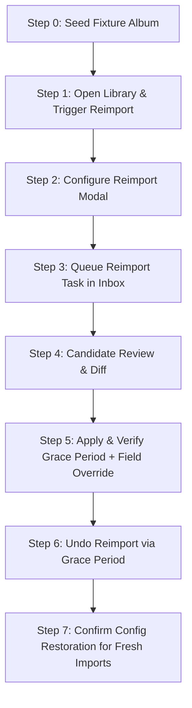

# Playbook 07: Reimport End-to-End

## Purpose & Scope

Validates the end-to-end reimport workflow in `beets-webimport` (the web UI equivalent of `beet import -L -S <mbid> --from-scratch --set navidrome_library=kids`).

This playbook exercises:
1. Selecting an existing library album from the **Library** tab and opening album details.
2. Triggering the **Reimport** modal (`button[data-reimport]`).
3. Verifying the `--from-scratch` toggle (`input[data-fromscratch]`) visual cues (bold/danger highlighting on check without requiring a blocking modal confirmation).
4. Providing a `--set field=value` override (`input[data-setlib]`, e.g. `kids`) and verifying it survives `--from-scratch` metadata clearing.
5. Reviewing and applying reimport candidates in the **Inbox** review pipeline.
6. Verifying the reimported album enters the **Grace Period** and can be undone from the **Undo** tab (`#tabs button[data-tab="undo"]`).
7. Confirming that the temporary global config mutation (`_temporary_import_config` per ADR-0005) is cleanly restored in `finally`, leaving subsequent fresh imports unaffected by stale `from_scratch` or `set_fields` values.

## References

- `.scratch/webimport/spec.md` — *Post-import: Reimport* (User Stories 26–31) and *Testing Decisions*
- `docs/adr/0005-reimport-via-temporary-config-mutation.md` — Temporary global config mutation context manager
- `docs/adr/0009-playwright-against-real-server-over-test-client-scripts.md` — Real Playwright E2E testing against a live server

---

## Prerequisites & Disposable Setup

### 1. Reset Test Library

Wipe the test library database and destination directories before running:

```bash
scripts/dev-reset.sh
```

### 2. Start the Server

Start the real `beet webimport` server:

```bash
scripts/dev-server.sh
```

The server listens on `http://localhost:8338`.

### 3. Required Network Hosts (Sandbox Allowlist)

Real MusicBrainz and Cover Art Archive lookups require outbound HTTP/HTTPS access to:
- `musicbrainz.org`, `*.musicbrainz.org`
- `coverartarchive.org`, `*.coverartarchive.org`
- `archive.org`, `*.archive.org`
- `itunes.apple.com`, `*.mzstatic.com`

---

## Deterministic Execution Steps



### Step 0: Seed Initial Test Fixture Album

Import the initial Mulan test album into the disposable library to establish a baseline.

1. **Navigate to App:**
   - Playwright tool call: `browser_navigate(url="http://localhost:8338")`
   - Playwright tool call: `browser_snapshot()`
2. **Start Fresh Import:**
   - Playwright tool call: `browser_click(target="#inbox-dirs .card button[data-start]", element="Start import button for Mulan folder")`
   - Playwright tool call: `browser_wait_for(text="Awaiting candidate review")`
3. **Review & Force Target MusicBrainz ID:**
   - Playwright tool call: `browser_click(target="#pending-reviews .card button[data-review]", element="Review button for pending Mulan import")`
   - Playwright tool call: `browser_type(target="div#modal-root input[data-mbid]", text="4e929666-952f-473c-baf2-97c9ca6bfbbe")`
   - Playwright tool call: `browser_click(target="div#modal-root button[data-use-id]", element="Use ID button")`
   - Playwright tool call: `browser_wait_for(text="Jerry Goldsmith, Matthew Wilder & David Zippel")`
4. **Apply Candidate 0:**
   - Playwright tool call: `browser_click(target="div#modal-root .candidate:first-child button[data-select]", element="Select candidate button")`
   - Playwright tool call: `browser_click(target='#tabs button[data-tab="undo"]', element="Undo tab button")`
   - Playwright tool call: `browser_wait_for(text="Undoable for")`
5. **Expected Outcome:**
   - Album is fully imported into `.library/` with default `navidrome_library: unassigned`.
   - Undo record exists in `#undo-list`.

---

### Step 1: Locate Applied Album in Library and Trigger Reimport

1. **User Action:**
   - Switch to the **Library** tab and click the imported album tile to open album details.
2. **Playwright Tool Calls:**
   ```json
   // 1. Switch to Library tab
   browser_click({
     "target": "#tabs button[data-tab=\"library\"]",
     "element": "Library tab button"
   })
   ```
   ```json
   // 2. Wait for album grid to render
   browser_wait_for({
     "text": "Jerry Goldsmith, Matthew Wilder & David Zippel"
   })
   ```
   ```json
   // 3. Take snapshot of library grid
   browser_snapshot()
   ```
   ```json
   // 4. Click the album tile to open Album Detail modal
   browser_click({
     "target": "#album-grid .album-tile",
     "element": "Mulan album tile"
   })
   ```
   ```json
   // 5. Verify Album Detail modal and click Reimport
   browser_wait_for({
     "text": "Save (auto-move if path changes)"
   })
   ```
   ```json
   browser_click({
     "target": "div#modal-root button[data-reimport]",
     "element": "Reimport… button in album detail modal"
   })
   ```
3. **Expected Observable Outcome:**
   - Album detail modal opens showing tracklist and `navidrome_library` field initialized to `unassigned`.
   - Clicking `button[data-reimport]` dismisses the detail modal and immediately opens the **Reimport** modal (`div#modal-root h3` with text `Reimport 1 album(s)`).

---

### Step 2: Configure Reimport (`--from-scratch` and `--set` Override)

1. **User Action:**
   - Enter target MusicBrainz ID or query into `input[data-mbid]`.
   - Toggle the `--from-scratch` checkbox (`input[data-fromscratch]`).
   - Enter `kids` into the `navidrome_library` override field (`input[data-setlib]`).
   - Click **Run reimport** (`button[data-go]`).
2. **Playwright Tool Calls:**
   ```json
   // 1. Enter target MusicBrainz ID (or URL)
   browser_type({
     "target": "div#modal-root input[data-mbid]",
     "text": "4e929666-952f-473c-baf2-97c9ca6bfbbe",
     "element": "MusicBrainz ID input in reimport modal"
   })
   ```
   ```json
   // 2. Click the --from-scratch checkbox
   browser_click({
     "target": "div#modal-root input[data-fromscratch]",
     "element": "--from-scratch checkbox"
   })
   ```
   ```json
   // 3. Capture snapshot to verify visual highlight (bold & danger color)
   browser_snapshot()
   ```
   ```json
   // 4. Enter --set navidrome_library override
   browser_type({
     "target": "div#modal-root input[data-setlib]",
     "text": "kids",
     "element": "navidrome_library --set override input"
   })
   ```
   ```json
   // 5. Submit reimport job
   browser_click({
     "target": "div#modal-root button[data-go]",
     "element": "Run reimport button"
   })
   ```
3. **Expected Observable Outcome:**
   - When `input[data-fromscratch]` is checked, its parent label updates inline styles to `font-weight: bold` and `color: var(--danger)` (red accent), making its destructive nature visually evident without an intrusive confirmation dialog.
   - Clicking `button[data-go]` posts to `/api/reimport` with payload:
     ```json
     {
       "album_ids": [1],
       "search_id": "4e929666-952f-473c-baf2-97c9ca6bfbbe",
       "from_scratch": true,
       "set_fields": { "navidrome_library": "kids" }
     }
     ```
   - Modal closes and the UI automatically activates the **Inbox** tab (`#tab-inbox`).

---

### Step 3: Observe Reimport Review Task in Inbox

1. **User Action:**
   - Wait for the reimport task to be queued and processed by the worker pool.
2. **Playwright Tool Calls:**
   ```json
   // 1. Wait for pending review task to appear in Inbox tab
   browser_wait_for({
     "text": "Awaiting candidate review"
   })
   ```
   ```json
   // 2. Snapshot inbox view
   browser_snapshot()
   ```
3. **Expected Observable Outcome:**
   - Under `#pending-reviews`, a review card appears containing the album path / query and `button[data-review]`.

---

### Step 4: Review Candidates and Verify Diff

1. **User Action:**
   - Open the review modal and inspect matching candidates.
2. **Playwright Tool Calls:**
   ```json
   // 1. Click Review on the reimport task card
   browser_click({
     "target": "#pending-reviews .card button[data-review]",
     "element": "Review button for reimport task"
   })
   ```
   ```json
   // 2. Wait for candidate list to render
   browser_wait_for({
     "text": "distance 0.0"
   })
   ```
   ```json
   // 3. Capture snapshot of candidate cards and cover art comparison
   browser_snapshot()
   ```
3. **Expected Observable Outcome:**
   - Review modal opens showing candidates returned by MusicBrainz.
   - Focused candidate (`.candidate.focused`) shows track match info and distance rating. (Library reimports leave album art unchanged: the art choice applies to inbox imports only.)

---

### Step 5: Apply Reimport and Verify Grace Period & `--set` Survival

1. **User Action:**
   - Select candidate 0 to apply the reimport.
   - Verify that the album updates in the Library tab with the `--set` value (`navidrome_library=kids`) and that a new Grace Period undo record is created.
2. **Playwright Tool Calls:**
   ```json
   // 1. Select and apply candidate 0
   browser_click({
     "target": "div#modal-root .candidate:first-child button[data-select]",
     "element": "Select candidate 0 button"
   })
   ```
   ```json
   // 2. Switch to Undo tab to verify Grace Period entry
   browser_click({
     "target": "#tabs button[data-tab=\"undo\"]",
     "element": "Undo tab button"
   })
   ```
   ```json
   // 3. Wait for undo card to appear
   browser_wait_for({
     "text": "Undoable for"
   })
   ```
   ```json
   // 4. Snapshot Undo tab
   browser_snapshot()
   ```
   ```json
   // 5. Switch to Library tab to verify field override survival
   browser_click({
     "target": "#tabs button[data-tab=\"library\"]",
     "element": "Library tab button"
   })
   ```
   ```json
   // 6. Wait for album grid and verify badge text
   browser_wait_for({
     "text": "kids"
   })
   ```
   ```json
   // 7. Snapshot updated Library grid
   browser_snapshot()
   ```
3. **Expected Observable Outcome:**
   - Reimport applies through the standard pipeline: existing tags were wiped by `--from-scratch`, fresh MusicBrainz metadata was written, and `navidrome_library: kids` was applied.
   - The album's `.lib-badge` on the library tile displays `kids`, confirming `--set` survived `--from-scratch`.
   - In `#tab-undo`, a card appears displaying the reimported album with countdown timer `Undoable for ...s` and `button[data-undo]`.

---

### Step 6: Trigger Grace Period Undo on Reimport

1. **User Action:**
   - Click the **Undo** button in `#tab-undo` to undo the reimport.
2. **Playwright Tool Calls:**
   ```json
   // 1. Switch to Undo tab
   browser_click({
     "target": "#tabs button[data-tab=\"undo\"]",
     "element": "Undo tab button"
   })
   ```
   ```json
   // 2. Click Undo on the reimport record
   browser_click({
     "target": "#undo-list .card button[data-undo]",
     "element": "Undo button"
   })
   ```
   ```json
   // 3. Wait for undo list to become empty
   browser_wait_for({
     "text": "Nothing pending undo."
   })
   ```
   ```json
   // 4. Switch to Library tab and verify album removal
   browser_click({
     "target": "#tabs button[data-tab=\"library\"]",
     "element": "Library tab button"
   })
   ```
   ```json
   browser_snapshot()
   ```
3. **Expected Observable Outcome:**
   - Undo executes `remove(delete=True)` on the specific DB IDs captured during the reimport apply (ADR-0001).
   - Undo card disappears, showing `Nothing pending undo.`.
   - Album is removed from the SQLite database and destination `.library/` directory.

---

### Step 7: Confirm Global Config Mutation Is Restored (ADR-0005)

1. **User Action:**
   - Trigger a fresh import from `.inbox` to prove that the process-global `beets.config["import"]` restored its initial settings when `run_reimport` completed:
     - `import.from_scratch` must be `False` (not stuck on `True`).
     - `import.set_fields` must be `{"navidrome_library": "unassigned"}` (not carrying stale `kids`).
2. **Playwright Tool Calls:**
   ```json
   // 1. Switch to Inbox tab
   browser_click({
     "target": "#tabs button[data-tab=\"inbox\"]",
     "element": "Inbox tab button"
   })
   ```
   ```json
   // 2. Start import on inbox directory
   browser_click({
     "target": "#inbox-dirs .card button[data-start]",
     "element": "Start import button"
   })
   ```
   ```json
   // 3. Wait for pending review
   browser_wait_for({
     "text": "Awaiting candidate review"
   })
   ```
   ```json
   // 4. Open review, select candidate 0 as-is or apply match
   browser_click({
     "target": "#pending-reviews .card button[data-review]",
     "element": "Review button"
   })
   ```
   ```json
   browser_click({
     "target": "div#modal-root .candidate:first-child button[data-select]",
     "element": "Select candidate button"
   })
   ```
   ```json
   // 5. Switch to Library tab and verify default navidrome_library assignment
   browser_click({
     "target": "#tabs button[data-tab=\"library\"]",
     "element": "Library tab button"
   })
   ```
   ```json
   browser_wait_for({
     "text": "unassigned"
   })
   ```
   ```json
   browser_snapshot()
   ```
3. **Expected Observable Outcome:**
   - The fresh import receives the baseline configuration default `navidrome_library: unassigned`.
   - Proves `_temporary_import_config` exited cleanly and restored `beets.config["import"]["from_scratch"]` and `beets.config["import"]["set_fields"]` back to their defaults in its `finally` block (ADR-0005).

---

## Failure Modes & Diagnostics

1. **Transient MusicBrainz / Cover Art Archive 502s:**
   - CAA occasionally returns HTTP 502/503 during art fetch. If "Resolving art…" or "No Cover Art Available" appears, verify network proxy settings or retry candidate selection.
2. **Task Queue Polling Race:**
   - When forcing a new MusicBrainz ID via `search_id`, the worker pops the old task and creates a new one. The browser UI waits for the new task to be registered before presenting candidates.
3. **Stale Config Leakage:**
   - If a fresh import unexpectedly gets assigned `navidrome_library: kids` or wipes non-standard tags, check `beetsplug/webimport/reimport.py`'s `_temporary_import_config` context manager for proper restoration on exit.
