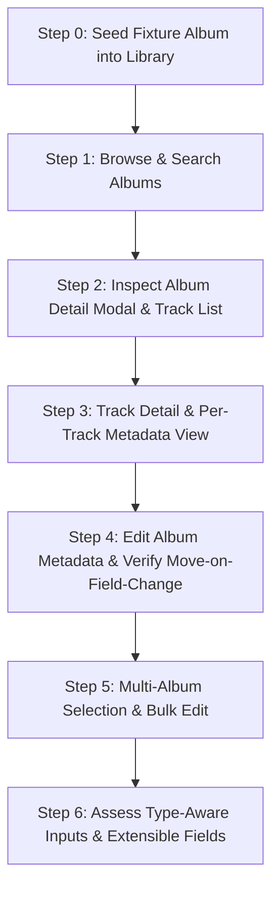

# Playbook 20: Library Browse & Metadata Editing Coverage Gap


## Purpose & Scope

This playbook specifies the end-to-end verification and gap measurement procedures for the **Library Browse & Metadata Editing** capabilities in `beets-webimport`, covering User Stories 32–42 from `.scratch/webimport/spec.md`.

It exercises and validates:
1. **Library Browse & Text Search (Story 32):** Browsing albums in the grid and filtering albums using beets query syntax across the library.
2. **Cover Art Thumbnails & Fallbacks (Stories 33, 34):** Serving art from `artpath` and handling fallback/placeholder states.
3. **Album View & Track Listing (Story 35):** Opening album detail modals, viewing metadata, and inspecting track lists.
4. **Track Detail View (Story 35):** Opening individual track detail views and inspecting full item metadata.
5. **Metadata Editing (Story 36, 38):** Editing album-level and track-level fields, including extensible custom fields.
6. **Type-Aware Inputs (Story 37):** Specialized input controls (date pickers, tag/genre chips, fallback text boxes).
7. **Multi-Album Bulk Edit (Story 39):** Multi-selecting albums and applying batch field updates.
8. **Move-on-Field-Change (Stories 40, 41):** Automatic filesystem relocation when metadata edits alter destination paths per beets path templates (`copy: yes`, `move: no` configuration).
9. **Concurrency Model (Story 42):** Validation under the single-user model.

---

## Prerequisites & Environment Setup

### 1. Reset Test Library and Configuration
Clear any existing library database, cache files, and imported media before beginning:

```bash
scripts/dev-reset.sh
```

Ensure test audio files exist in `.inbox/Mulan (Original Motion Picture Soundtrack)`:
```bash
ls -la ".inbox/Mulan (Original Motion Picture Soundtrack)"
```

### 2. Start the Webimport Server
Start the in-process server using the test configuration:

```bash
scripts/dev-server.sh
```

The server serves the web interface at `http://localhost:8338`.

### 3. Network Allowlist
Real MusicBrainz and Cover Art Archive lookups require outbound HTTP/HTTPS access to:
- `musicbrainz.org`, `*.musicbrainz.org`
- `coverartarchive.org`, `*.coverartarchive.org`
- `archive.org`, `*.archive.org`
- `itunes.apple.com`, `*.mzstatic.com`

---

## Verification Flow Overview



---

## Step-by-Step Playwright Verification Procedure

### Step 0: Seed Initial Fixture Album into Library

1. **Navigate to App & Import Mulan:**
   ```json
   // browser_navigate
   { "url": "http://localhost:8338" }
   ```
   ```json
   // browser_click
   {
     "element": "Start import button for Mulan directory",
     "target": "#inbox-dirs .card button[data-start]"
   }
   ```
   ```json
   // browser_wait_for
   { "text": "Candidates ready for review" }
   ```
2. **Review and Apply Candidate:**
   ```json
   // browser_click
   {
     "element": "Review button",
     "target": "#pending-reviews .card button[data-review]"
   }
   ```
   ```json
   // browser_type
   {
     "element": "MusicBrainz ID input",
     "target": "div#modal-root input[data-mbid]",
     "text": "4e929666-952f-473c-baf2-97c9ca6bfbbe"
   }
   ```
   ```json
   // browser_click
   {
     "element": "Use ID button",
     "target": "div#modal-root button[data-use-id]"
   }
   ```
   ```json
   // browser_wait_for
   { "text": "Jerry Goldsmith, Matthew Wilder & David Zippel" }
   ```
   ```json
   // browser_click
   {
     "element": "Select candidate button",
     "target": "div#modal-root .candidate:first-child button[data-select]"
   }
   ```

**Expected Outcome:**
- Album files are imported into `.library/unassigned/Jerry Goldsmith, Matthew Wilder & David Zippel/Mulan (Original Motion Picture Soundtrack)/`.
- Album database entry exists with default `navidrome_library: unassigned`.

---

### Step 1: Browse & Search Library (Story 32)

1. **Navigate to the Library Tab:**
   ```json
   // browser_click
   {
     "element": "Library tab button",
     "target": "#tabs button[data-tab=\"library\"]"
   }
   ```
   ```json
   // browser_snapshot
   {}
   ```
   **Expected Outcome:**
   - Section `#tab-library` is active.
   - `#album-grid` displays an album tile with artist "Jerry Goldsmith, Matthew Wilder & David Zippel", title "Mulan (Original Motion Picture Soundtrack)", and `.lib-badge` showing `unassigned`.
   - Album tile art loads from `/api/library/albums/1/art` (or displays placeholder gracefully per #27).

2. **Test Search Filtering:**
   ```json
   // browser_type
   {
     "element": "Library search input",
     "target": "#lib-search",
     "text": "Mulan"
   }
   ```
   ```json
   // browser_wait_for
   { "text": "Mulan (Original Motion Picture Soundtrack)" }
   ```
   ```json
   // browser_type
   {
     "element": "Library search input with non-matching query",
     "target": "#lib-search",
     "text": "NonexistentArtistXYZ"
   }
   ```
   ```json
   // browser_wait_for
   { "text": "No albums matching “NonexistentArtistXYZ” found." }
   ```

**Assessment:**
- **Status:** **Pass**
- Search by artist/album query syntax works as expected. Empty states render cleanly per ticket #29.

---

### Step 2: Album View & Track List (Stories 35, 36, 38)

1. **Clear Search and Open Album Detail Modal:**
   ```json
   // browser_type
   {
     "element": "Library search input",
     "target": "#lib-search",
     "text": ""
   }
   ```
   ```json
   // browser_click
   {
     "element": "Album tile",
     "target": "#album-grid .album-tile:first-child"
   }
   ```
   ```json
   // browser_snapshot
   {}
   ```

**Expected vs Observed Outcome:**
- **Observed:**
  - Modal opens with title `Jerry Goldsmith, Matthew Wilder & David Zippel – Mulan (Original Motion Picture Soundtrack)`.
  - Displays a single input `<input data-field="navidrome_library" value="unassigned" />`.
  - Displays a "Tracks" list showing 4 tracks (`1. Honor to Us All`, `2. Reflection`, `3. I'll Make a Man Out of You`, `4. A Girl Worth Fighting For`).
- **Gaps Identified:**
  - Full album metadata (year, genre, label, catalog number, MBID, album type) is present in backend `GET /api/library/albums/1` response but is not rendered or editable in the UI (logged in **#31**).
  - No affordance to add or edit custom flexible fields (logged in **#31**).

**Assessment:**
- **Status:** **Partial** (Track list and basic fields present; full metadata view and custom field editing missing).

---

### Step 3: Track Detail View & Per-Track Metadata (Stories 35, 36)

1. **Attempt to Select a Track from the Track List:**
   ```json
   // browser_click
   {
     "element": "First track row in album detail modal",
     "target": "div#modal-root [data-tracks] .card:first-child"
   }
   ```
   ```json
   // browser_snapshot
   {}
   ```

**Expected vs Observed Outcome:**
- **Expected:** Clicking a track opens a Track Detail modal displaying full track metadata (title, artist, track number, disc, length, bitrate, audio format, MBID) and provides editable form fields to update track metadata.
- **Observed:** Clicking a track row has no click handler and does nothing. Only context menu/long-press allows applying tags.
- **Gaps Identified:**
  - Dedicated track detail modal is missing in the UI (logged in **#30**).
  - Per-track metadata editing UI is missing (logged in **#32**).

**Assessment:**
- **Status:** **Missing** (Backend endpoints `GET /api/library/items/<id>` and `POST /api/library/items/<id>/fields` exist, but UI views are unbuilt).

---

### Step 4: Metadata Editing & Move-on-Field-Change (Stories 36, 40, 41)

1. **Edit `navidrome_library` on the Album:**
   ```json
   // browser_type
   {
     "element": "navidrome_library input",
     "target": "div#modal-root input[data-field=\"navidrome_library\"]",
     "text": "soundtracks"
   }
   ```
   ```json
   // browser_click
   {
     "element": "Save album button",
     "target": "div#modal-root button[data-save-album]"
   }
   ```
   ```json
   // browser_wait_for
   { "text": "Album saved." }
   ```

2. **Verify Filesystem Move on Disk:**
   Verify files moved from `.library/unassigned/...` to `.library/soundtracks/...`:
   ```bash
   ls -la ".library/soundtracks/Jerry Goldsmith, Matthew Wilder & David Zippel/Mulan (Original Motion Picture Soundtrack)"
   test ! -d ".library/unassigned/Jerry Goldsmith, Matthew Wilder & David Zippel/Mulan (Original Motion Picture Soundtrack)"
   ```

**Assessment:**
- **Status:** **Pass**
- `set_album_fields` invokes `_paths_would_change` and `album.move()`, correctly relocating the files on disk when path-relevant fields change. Beets' `%aunique{}` handles naming collisions.

---

### Step 5: Multi-Album Selection & Bulk Edit (Story 39)

1. **Select Album Checkbox:**
   ```json
   // browser_click
   {
     "element": "Album selection checkbox",
     "target": "#album-grid .album-tile:first-child input[data-select]"
   }
   ```
   ```json
   // browser_snapshot
   {}
   ```
   **Expected Outcome:**
   - `#bulk-bar` becomes visible with text `"1 selected"`.
   - Clicking `#bulk-apply` prompts for `navidrome_library` value and updates all selected albums via `POST /api/library/albums/bulk_fields`.

**Gaps Identified:**
- Bulk edit only supports setting `navidrome_library` through a browser `prompt()`. The `#bulk-field-value` dropdown is unused, and arbitrary fields (e.g. `genre`, `year`, custom tags) cannot be selected for bulk update from the UI (logged in **#34**).

**Assessment:**
- **Status:** **Partial** (Bulk editing works for `navidrome_library`, but arbitrary field selection is missing).

---

### Step 6: Type-Aware Inputs & Extensible Custom Fields (Stories 37, 38)

1. **Evaluate Input Types across Modals:**
   - Date inputs (release year, original year) render as plain text strings rather than date/year controls.
   - Multi-value fields (e.g. `genres`, `mood`) lack chip/tag interactive widgets for adding/removing items in the album/track edit views.
   - Extensible flexible fields cannot be defined or edited directly in the album/track modals without dropping to the Tag Vocabulary or CLI.

**Gaps Identified:**
- Type-aware inputs (date picker, chips) missing (logged in **#33**).
- Dynamic custom field editor missing (logged in **#31**, **#32**).

**Assessment:**
- **Status:** **Missing / Partial** (Tracked in **#31**, **#32**, **#33**).

---

## Story-by-Story Coverage Gap Assessment

| Story | Requirement Description | Implementation Status | Verified Behavior & Observed Gaps | Follow-up Ticket |
|---|---|---|---|---|
| **32** | Browse library by artist/album with text search | **Pass** | Verified in `loadLibrary()` and `#lib-search`. Query syntax works; empty states confirmed per #29. | — |
| **33** | Album art thumbnails from `artpath` cached/resized (200x200) | **Partial** | Art is served from `artpath`, but server-side thumbnail resizing/caching layer is not yet implemented. | #17 |
| **34** | Embedded tag art fallback when `artpath` is null | **Missing** | Endpoint returns 404 when `artpath` is null without attempting embedded art extraction fallback. | #17 |
| **35** | Full album metadata view + track list, and track view with full track metadata | **Partial** | Album detail shows title/artist and track list. Track rows have no click handler to view track metadata; full album metadata is omitted. | #30, #31 |
| **36** | Edit metadata per-track and whole-album, including custom fields | **Partial** | UI only exposes editing `navidrome_library` on albums. Per-track field editing UI is missing entirely. | #31, #32 |
| **37** | Type-aware inputs (date picker, multi-value chips for genres, text fallback) | **Missing** | All inputs are un-typed text fields; no date pickers or multi-value chip controls exist. | #33 |
| **38** | Extensible custom fields (flexible attributes) in metadata editor | **Partial** | Backend flexible attribute storage exists; UI lacks affordance to add or edit arbitrary custom attributes on albums/tracks. | #31, #32 |
| **39** | Multi-select across albums and bulk edit | **Partial** | Multi-select checkboxes and bulk bar exist, but bulk edit is hardcoded to prompt for `navidrome_library` only. | #34 |
| **40** | Move-on-Field-Change triggered on metadata edits affecting destination path | **Pass** | Verified in `set_album_fields()` / `set_item_fields()` via `_paths_would_change()` and `album.move()`. | — |
| **41** | Beets `%aunique{}` disambiguation on Move-on-Field-Change | **Pass** | Handled natively by beets `Item.move()` / `Album.move()` during path formatting. | — |
| **42** | Single-user concurrency model | **Pass** | Single-user architecture confirmed per specification and ADR-0006. | — |
