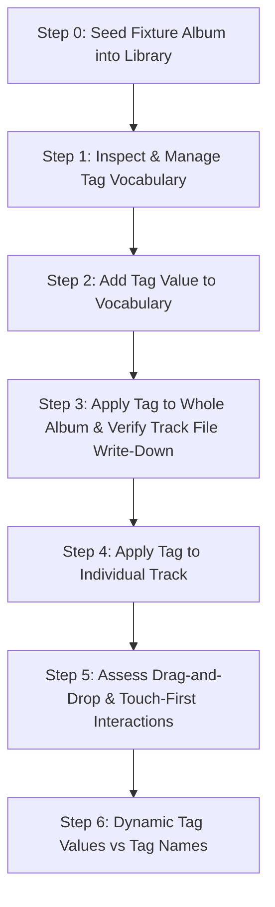

# Playbook 21: Custom Tags (Tag Vocabulary) Coverage Gap

## Purpose & Scope

This playbook specifies the end-to-end verification and gap measurement procedures for the **Custom Tags (Navidrome Integration)** capabilities in `beets-webimport`, covering User Stories 43–46 from `.scratch/webimport/spec.md`.

It exercises and validates:
1. **Tag Vocabulary Management (Story 43):** Maintaining a reusable, GUI-managed tag vocabulary (starting with `mood`, multi-valued) ahead of use to prevent typo accumulation.
2. **Tag Application via Drag-and-Drop or Touch Equivalent (Story 44):** Applying tags to individual tracks or whole albums quickly during a library browsing session.
3. **Album-Level Tag Write-Down to Track Files (Story 45):** Verifying that applying a tag at the album level writes down to every track file (`beet write` equivalent) so Navidrome song-level smart playlists capture it.
4. **Immediate Tag Value Application vs. Tag Name Configuration (Story 46):** Verifying that new tag values apply dynamically without plugin restart, while acknowledging manual `navidrome.toml` configuration for brand-new tag fields.

---

## Prerequisites & Environment Setup

### 1. Reset Test Library and Configuration
Clear any existing library database, cache files, and imported media before beginning:

```bash
scripts/dev-reset.sh
```

Ensure test audio files exist in `.inbox/Mulan (Original Motion Picture Soundtrack)`:
```bash
ls -la ".inbox/Mulan (Original Motion Picture Soundtrack)"
```

### 2. Start the Webimport Server
Start the in-process server using the test configuration:

```bash
scripts/dev-server.sh
```

The server serves the web interface at `http://localhost:8338`.

### 3. Network Allowlist
Real MusicBrainz and Cover Art Archive lookups require outbound HTTP/HTTPS access to:
- `musicbrainz.org`, `*.musicbrainz.org`
- `coverartarchive.org`, `*.coverartarchive.org`
- `archive.org`, `*.archive.org`
- `itunes.apple.com`, `*.mzstatic.com`

---

## Verification Flow Overview



---

## Step-by-Step Playwright Verification Procedure

### Step 0: Seed Initial Fixture Album into Library

1. **Navigate to App & Import Mulan:**
   ```json
   // browser_navigate
   { "url": "http://localhost:8338" }
   ```
   ```json
   // browser_click
   {
     "element": "Start import button for Mulan directory",
     "target": "#inbox-dirs .card button[data-start]"
   }
   ```
   ```json
   // browser_wait_for
   { "text": "Awaiting candidate review" }
   ```
2. **Review and Apply Candidate:**
   ```json
   // browser_click
   {
     "element": "Review button",
     "target": "#pending-reviews .card button[data-review]"
   }
   ```
   ```json
   // browser_type
   {
     "element": "MusicBrainz ID input",
     "target": "div#modal-root input[data-mbid]",
     "text": "a5483fb3-634b-4254-a966-de33cefd1f17"
   }
   ```
   ```json
   // browser_click
   {
     "element": "Use ID button",
     "target": "div#modal-root button[data-use-id]"
   }
   ```
   ```json
   // browser_wait_for
   { "text": "Jerry Goldsmith, Matthew Wilder & David Zippel" }
   ```
   ```json
   // browser_click
   {
     "element": "Select candidate button",
     "target": "div#modal-root .candidate:first-child button[data-select]"
   }
   ```

**Expected Outcome:**
- Album files are imported into `.library/unassigned/Jerry Goldsmith, Matthew Wilder & David Zippel/Mulan (Original Motion Picture Soundtrack)/`.
- SQLite database has 1 album (ID 1) with 4 items (IDs 1, 2, 3, 4).

---

### Step 1: Inspect & Manage Tag Vocabulary (Story 43)

1. **Navigate to the Tags Tab:**
   ```json
   // browser_click
   {
     "element": "Tags tab button",
     "target": "#tabs button[data-tab=\"tags\"]"
   }
   ```
   ```json
   // browser_snapshot
   {}
   ```

**Expected vs Observed Outcome:**
- **Observed:**
  - Section `#tab-tags` becomes active.
  - `#tag-fields` renders a card for the default `mood` field (seeded from `wi_config["tag_fields"]`).
  - The card displays `<h3>mood</h3>`, an empty `.tags-values` container, and an input with an "Add" button (`input[data-new]`, `button[data-add]`).
- **Gaps Identified:**
  - While adding values to existing fields is supported, there is no GUI affordance to create new tag fields (e.g. `occasion`, `energy`) directly from the web interface (logged in **#36**).
  - There is no GUI affordance or API endpoint to delete tag fields or delete individual tag values from the vocabulary (logged in **#36**).

**Assessment:**
- **Status:** **Partial** (Pre-seeded fields allow value addition; full vocabulary curation including field creation and value deletion is missing in UI/API).

---

### Step 2: Add Tag Values to Vocabulary (Story 43, 46)

1. **Add Tag Values `chill` and `uplifting` to `mood`:**
   ```json
   // browser_type
   {
     "element": "New tag value input",
     "target": "#tag-fields .card input[data-new]",
     "text": "chill"
   }
   ```
   ```json
   // browser_click
   {
     "element": "Add tag value button",
     "target": "#tag-fields .card button[data-add]"
   }
   ```
   ```json
   // browser_type
   {
     "element": "New tag value input",
     "target": "#tag-fields .card input[data-new]",
     "text": "uplifting"
   }
   ```
   ```json
   // browser_click
   {
     "element": "Add tag value button",
     "target": "#tag-fields .card button[data-add]"
   }
   ```
   ```json
   // browser_snapshot
   {}
   ```

**Expected Observable Outcome:**
- POST `/api/tags/mood` saves `"chill"` and `"uplifting"` into `tags.json`.
- UI reloads tags and displays two `.tag-chip` elements inside `.tags-values`: `chill` and `uplifting`.

**Assessment:**
- **Status:** **Pass** for value addition within pre-configured fields.

---

### Step 3: Apply Tag to Whole Album & Verify Track File Write-Down (Stories 44, 45)

1. **Trigger Tag Application to Album via API/UI:**
   ```json
   // browser_evaluate
   {
     "function": "async () => { await fetch('/api/tags/mood/apply', { method: 'POST', body: JSON.stringify({ field: 'mood', value: 'uplifting', scope: 'album', id: 1, add: true }) }); }"
   }
   ```

2. **Verify Library Database Persistence:**
   ```bash
   BEETSDIR=./.config .venv/bin/beet info -a "Mulan"
   BEETSDIR=./.config .venv/bin/beet info "Mulan"
   ```

3. **Verify Audio File Header Write-Down on Disk (`beet write` equivalent):**
   ```bash
   # Check raw file metadata using ffprobe or beet info for all 4 tracks
   BEETSDIR=./.config .venv/bin/beet info -i "mood"
   ```

**Expected Observable Outcome:**
- Album metadata has `mood: uplifting`.
- Every item (tracks 1–4) has `mood: uplifting` in SQLite database.
- Audio file headers on disk have been written with `mood: uplifting` via `item.try_write()`.

**Assessment:**
- **Status:** **Pass** (Backend and data layer write down album tags to every track file; tested by unit test `test_apply_tag_to_album_writes_down_to_all_tracks`).

---

### Step 4: Apply Tag to Individual Track (Story 44)

1. **Apply Tag `chill` to Track 1 only:**
   ```json
   // browser_evaluate
   {
     "function": "async () => { await fetch('/api/tags/mood/apply', { method: 'POST', body: JSON.stringify({ field: 'mood', value: 'chill', scope: 'item', id: 1, add: true }) }); }"
   }
   ```

2. **Verify Item vs Album Tag Isolation:**
   ```bash
   BEETSDIR=./.config .venv/bin/beet info "Reflection"
   ```

**Expected Observable Outcome:**
- Track 1 has multi-valued mood: `uplifting; chill`.
- Tracks 2–4 retain only `mood: uplifting`.
- Album retains `mood: uplifting`.

**Assessment:**
- **Status:** **Pass** (Data layer and backend endpoints handle individual item tagging and multi-value semicolon delimiter correctly).

---

### Step 5: Assess Drag-and-Drop & Touch-First Interactions (Story 44)

1. **Inspect Drag-and-Drop Implementation in UI:**
   - Tag chips (`.tag-chip`) have CSS class `grabbable` and `cursor: grab`, but lack HTML5 `draggable="true"` attributes and `dragstart`/`dragend` event listeners.
   - Album tiles (`.album-tile`) and track rows lack `dragover`/`drop` event listeners.
   - No visual feedback or drop targets exist during dragging.

2. **Inspect Touch-Equivalent Implementation in UI:**
   - Long-pressing a tag chip opens a context menu with "Apply to album/track…", which invokes JavaScript browser prompts (`prompt()` and `confirm()`) asking the user to manually enter an integer database ID.
   - In Library view, album tiles have no "Apply tag" action in their long-press menu.
   - In Album detail view, tracks have an "Apply tag…" long-press action, but it prompts for raw string field/value inputs rather than selecting from the Tag Vocabulary.

**Gaps Identified:**
- HTML5 drag-and-drop is completely absent (logged in **#35**).
- Touch workflow relies on manual typing of database IDs into `window.prompt()` modals rather than direct touch-selection or visual picker UI (logged in **#35**).

**Assessment:**
- **Status:** **Partial** (A raw prompt-based mechanism exists, but drag-and-drop and intuitive touch-first tagging workflows are missing).

---

### Step 6: Dynamic Tag Values vs Tag Names (Story 46)

1. **Verify Dynamic Tag Values:**
   - Adding a brand-new tag value (e.g. `energetic`) to the vocabulary and applying it to albums/tracks takes effect immediately without restarting the beets daemon or rebuilding the library.

2. **Verify Tag Name Configuration Boundary:**
   - Adding a brand-new tag *name* (e.g. `occasion`) requires adding the tag to `navidrome.toml` (`Tags.Occasion.Aliases`) and triggering a Navidrome rescan. Per spec, this is an accepted, expected-to-be-rare manual configuration step outside plugin control.

**Assessment:**
- **Status:** **Pass** (The plugin does not block or mishandle dynamic tag values; Navidrome configuration requirements are documented and expected).

---

## Story-by-Story Coverage Gap Assessment

| Story | Requirement Description | Implementation Status | Verified Behavior & Observed Gaps | Follow-up Ticket |
|---|---|---|---|---|
| **43** | Reusable, GUI-managed Tag Vocabulary (starting with `mood`, multi-valued) maintained ahead of time | **Partial** | Pre-seeded fields (`mood`) display and accept new values in `#tab-tags`. However, the GUI lacks controls to create new tag fields or delete existing vocabulary values/fields. | #36 |
| **44** | Apply tag to individual tracks or whole album via drag-and-drop or touch equivalent | **Partial** | Backend `POST /api/tags/<field>/apply` functions for album and track scopes. However, HTML5 drag-and-drop is not implemented, and the touch equivalent relies on typing raw database IDs into `window.prompt()`. | #35 |
| **45** | Album-level tag assignment writes down to every track file (`beet write`) | **Pass** | `apply_tag_to_album()` updates all item records and executes `item.try_write()` to write tags to audio files on disk. Verified in `tests/test_tags.py`. | — |
| **46** | New tag value works immediately; new tag name requires `navidrome.toml` edit & rescan | **Pass** | Plugin applies dynamic tag values immediately without restart. Navidrome configuration boundary is an accepted manual step per spec. | — |
